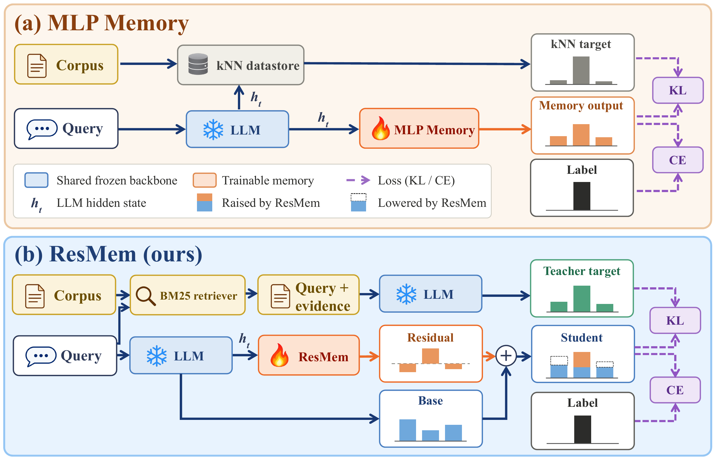

<p align="center">
  
</p>

<h3 align="center">From Lookups to Lessons: Turning Retrieved Knowledge into Parametric Memory</h3>

<p align="center">
  Changjiang Han, Ye Yuan, Bowei He, Weixu Zhang, Haolun Wu, Xue Liu, Jikun Kang<br>
  MBZUAI · McGill University · Mila – Quebec AI Institute · Salesforce Research
</p>

<p align="center">
  <a href="#citation">Paper</a> ·
  <a href="https://huggingface.co/RandHan/ResMem-Mistral-7B-v0.3">Model on Hugging Face</a>
</p>

---

**ResMem** stores retrieved knowledge in a small parametric memory attached to a frozen LLM, so that the model can use it at inference without a retriever, an index or a long context.

Retrieval-augmented generation keeps knowledge outside the model, at the cost of maintaining a corpus and index and of reading evidence on every query.
Existing parametric memories (MLP Memory, Memory Decoder) remove that cost by training a memory to imitate a kNN retriever.
Their loss never sees the base model, though, so a memory that imitates the retriever well can still override answers the base already had right.

ResMem trains the memory through the prediction it will later modify.

<p align="center">
  
</p>

- **Evidence-reading teacher.** Offline, the frozen LLM reads each training span together with BM25-retrieved passages, and its top-64 next-token distribution is cached as the target. No dense kNN datastore is built.
- **Residual objective.** The memory reads the LLM's hidden state $h_t$ and outputs a logit residual $s$. Distillation and next-token losses are computed on $z_B + s$, so positions the base already gets right give little gradient, and the memory learns a correction to the base rather than a second copy of the retriever.
- **Retrieval-free inference.** Only the frozen LLM and the memory remain: $p = \mathrm{softmax}(z_B + \gamma s)$, where $\gamma$ sets how strongly the memory adjusts the base.

## Highlights

With Mistral-7B-v0.3 and a memory trained on English Wikipedia, evaluated on 38,627 questions (token F1, %):

| Method | Open-domain QA | Long-tail QA | Multi-hop QA |
| --- | ---: | ---: | ---: |
| Base | 38.51 | 25.15 | 23.47 |
| + BM25-RAG | 31.87 | 25.86 | 26.27 |
| + LoRA | 38.71 | 26.51 | 25.32 |
| + Memory Decoder | 38.95 | 25.40 | 23.76 |
| + MLP Memory | 39.41 | 25.83 | 24.52 |
| **+ ResMem** | **39.73** | **26.91** | **26.29** |

- Improves EM and F1 over the base model on all five datasets (NQ, WebQuestions, TriviaQA, PopQA, HotpotQA), with the lowest answer perplexity among all methods.
- Breaks 21% fewer of the base model's correct answers than MLP Memory, while correcting 11% more of its errors.
- Retains 32.0 GiB instead of 602.0 GiB to build the teacher on a Wikipedia subset (18.8× less than the kNN pipeline).

## Quick start

```bash
git clone https://github.com/SSRand/From-Lookups-to-Lessons.git
cd From-Lookups-to-Lessons
pip install -r requirements.txt
```

Load the released memory on top of Mistral-7B-v0.3:

```python
import torch
from transformers import AutoModelForCausalLM, AutoTokenizer
from resmem.memory import capture_memory_input, load_memory

tok = AutoTokenizer.from_pretrained("mistralai/Mistral-7B-v0.3")
base = AutoModelForCausalLM.from_pretrained("mistralai/Mistral-7B-v0.3", torch_dtype=torch.bfloat16).cuda().eval()
memory = load_memory("RandHan/ResMem-Mistral-7B-v0.3", base, "cuda")

store = {}
capture_memory_input(base, store)  # records h_t on every base forward
ids = tok("Q: Who wrote Hamlet?\nA:", return_tensors="pt").input_ids.cuda()
with torch.no_grad():
    z_base = base(ids).logits[:, -1].float()
    s = memory(store["hidden_states"][:, -1].float())
    z = z_base + 0.4 * s  # gamma = 0.4
print(tok.decode(z.argmax(-1)))
```

## Train a memory

```bash
# 1. BM25 index over pre-tokenized corpus shards (train/*.arrow with input_ids/labels)
python -m teacher.build_bm25_index --data WIKI --out bm25

# 2. Retrieve the top-3 passages for each 64-token span and assemble (evidence + span) sequences (CPU)
python -m teacher.prepare_contexts --data WIKI --bm25 bm25 --out prepped --workers 32

# 3. Cache the top-64 distributions of the frozen LLM reading the evidence (GPU)
python -m teacher.forward_teacher --prepped prepped --out teacher_cache --world 8

# 4. Train the memory against the frozen LLM
python -m train.cache_manifest --cache teacher_cache --out teacher_cache/manifest.json
python -m train.pretrain --cache teacher_cache --cache-manifest teacher_cache/manifest.json --out runs/resmem --world 8 --epochs 1
```

`WIKI` is a pre-tokenized corpus such as [Rubin-Wei/enwiki-dec2021-preprocessed-mistral](https://huggingface.co/datasets/Rubin-Wei/enwiki-dec2021-preprocessed-mistral).
Hyperparameters are listed in [`docs/experimental_protocol.md`](docs/experimental_protocol.md); every entry point documents its options in its module docstring.

## Evaluate on knowledge QA

```bash
# Test and validation sets
python -m qa.data.build_test_sets --nq NQ_TEST --triviaqa TQA_TEST --webq WEBQ_TEST --hotpotqa HOTPOT_DEV --popqa POPQA --data-root data/qa/test
python -m qa.data.build_validation_sets --test-root data/qa/test/frozen --nq NQ_DEV --triviaqa TQA_DEV --webq WEBQ_DEV \
    --hotpotqa HOTPOT_TRAIN --popqa ENTITYQUESTIONS --output-root data/qa/validation

# Select gamma on validation EM, then evaluate on the test set
CKPT=RandHan/ResMem-Mistral-7B-v0.3
python -m qa.run_grid --split-root data/qa/validation/frozen --method resmem --checkpoint $CKPT --coefficients GRID --output runs/resmem/validation
python -m qa.select_coefficients --split-root data/qa/validation/frozen --grid runs/resmem/validation --output runs/resmem/selected.json
python -m qa.run_grid --split-root data/qa/test/frozen --method resmem --checkpoint $CKPT --selected runs/resmem/selected.json --score-answers --output runs/resmem/test
python -m qa.evaluate --split-root data/qa/test/frozen --method ResMem=runs/resmem/test:runs/resmem/selected.json
```

The same commands evaluate `--method mlpmemory` and `--method memory_decoder`; `base` and `lora` take no coefficient.
The analyses of corrections and harms, the shared-teacher ablation, precision and deployment cost, and the tokenwise gate are in `correction_harm/`, `shared_teacher_ablation/`, `precision/` and `gate/`.

## Citation

```bibtex
@article{han2026lookups,
  title   = {From Lookups to Lessons: Turning Retrieved Knowledge into Parametric Memory},
  author  = {Han, Changjiang and Yuan, Ye and He, Bowei and Zhang, Weixu and Wu, Haolun and Liu, Xue and Kang, Jikun},
  journal = {arXiv preprint},
  year    = {2026}
}
```

## License

Apache-2.0.
